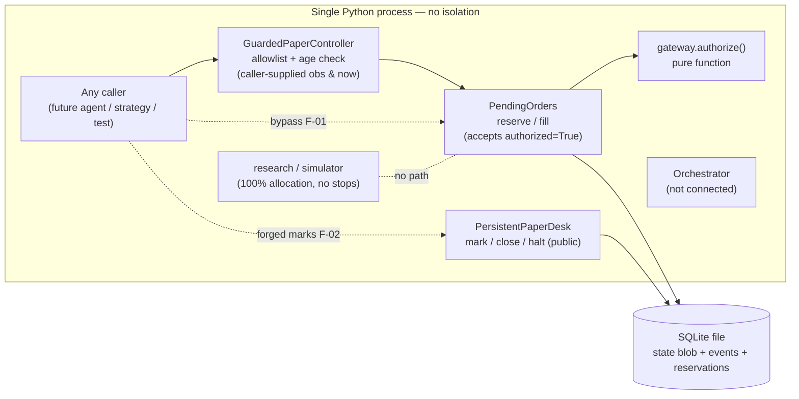
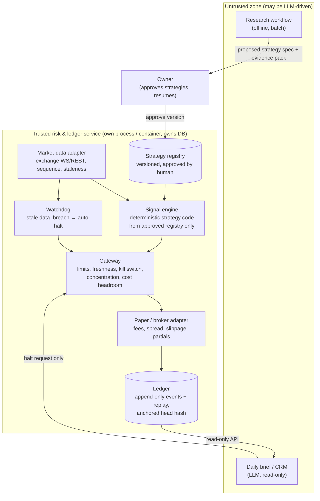

# 02 — Architecture review

## Development history (what the evidence shows)

- The full history (115 commits, not shallow) was reviewed. **All 115 commits were made on 2026-11-18 between 11:53 and 13:26 EST**, about 93 minutes. Every commit is authored as `Rishabh Sinha <rishabhsinha2611@gmail.com>`. The brief says GPT-6 did the engineering, but git metadata can't show which commits were machine-generated. I attribute decisions to "the primary workstream" and cite commits.
- The commit pattern is one file per commit ("Add research-first scaffold: .gitignore", then "…: .env.example"). There are duplicated messages (6 × "Allow 24/7 crypto positions across UTC midnight", 4 × "Fix CI syntax and remove remaining midnight liquidations", 3 × "Update tests for renewed fill authorization…"). Everything went directly to `main`, with no branches or PRs. CI runs #63–#77 failed on `main` (README).

## Implementation inventory (reconstructed from code)

| Capability | Status | Evidence |
|---|---|---|
| Deterministic gateway (`authorize`) | **Implemented and tested** | `gateway.py`; `test_gateway_strategies.py`; mutants M1/M2/M6 caught |
| SQLite ledger: snapshot, events, restart | **Implemented and tested** (hardened on audit branch) | `persistent_paper.py`; SIGKILL and replay tests |
| Pending reservations and idempotent order IDs | **Implemented and tested** | `pending_orders.py`; process races |
| Strategy allowlist and freshness controller | **Implemented, inadequately enforced** (bypassable, F-01/F-02) | `paper_controller.py` |
| Synthetic stops | **Implemented; was broken on the ordinary mark path** (F-03, fixed) | `paper_stops.py`, `_mark_and_stop` |
| UTC daily roll | **Implemented and tested** (clock fixed, F-06) | `roll_utc_day` |
| Kill switch | **Partially implemented**: manual only, no auto-trigger, no resume | `halt()` |
| Fees, spread, slippage, partial fills in the ledger | **Not implemented** | — |
| Market-data adapter / feed | **Not implemented** (documented as a blocker) | — |
| Broker / exchange paper integration (Alpaca) | **Documented, not implemented** (`.env.example`, `ROADMAP.md` Phase 2) | — |
| Research backtests (SMA, 3 families), rolling splits | **Implemented, synthetic tests only**; never run on real data in the repo | `research.py`, `simulator.py`, `pipeline.py` |
| Research → execution path | **Not implemented** | — |
| Experiment registry / audit records | **Implemented, unused** outside tests | `audit.py` |
| Tool registry for agents | **Implemented** (3 SMA tools); roles are self-declared strings | `tools.py` |
| Event router and 11 role identities | **Scaffolding**: no handlers, no LLM calls, not connected to execution | `orchestrator.py`, `agent_contracts.py` |
| 11 LLM specialist agents | **Planned, not started** | `ARCHITECTURE.md`, `AGENT_EVENTS.md` |
| WhatsApp CRM | **Planned, not started** | — |
| Performance auditor | **Not started**; attribution added on audit branch | — |
| `risk.check_proposed_risk` | **Architecturally unnecessary** (dead; superseded by gateway) | only `test_risk.py` imports it |
| "Wendy" tool | **Undefined** in the repo | `TOOLS.md`, `ARCHITECTURE.md` |

## Current architecture (as built)

### Answers to the architecture questions

1. **Is it technically sound?** The *intent* is sound: a deterministic gateway that AI can't override, plus a persistent ledger. The *implementation* is a set of in-process Python objects, so the "boundary" is a naming convention. Sound as a library; not sound as a security boundary.
2. **Is the trust boundary enforced?** No. Authorization flags, prices and (until this audit) the clock all come from the caller (F-01, F-02, F-06).
3. **Can an AI agent bypass the risk gateway?** It can't avoid `authorize()`. Every entry calls it, and the combined-risk and daily-loss checks held in every adversarial and randomized test. It *can* bypass the allowlist and freshness (by passing `True`) and can make the gateway reason over forged prices. If agent-generated code runs in the same process with filesystem access, it can also write the SQLite file directly. The integrity check now detects that unless both tables are rewritten consistently.
4. **Are 11 roles necessary?** No (see `07`). Four to five components cover everything that affects P&L, and only two need an LLM.
5. **Duplicated responsibilities?** Yes. Technical and Quant overlap; Bull and Bear duplicate the PM's job; "Risk Controller" names both an agent and the deterministic gateway; Execution Agent is deterministic code.
6. **Deterministic instead of LLM?** Risk Controller, Execution, Performance Auditor, and most of Technical and Quant.
7. **Excessive for $500 paper?** The *ledger* hardening is proportionate if the goal is a product. The *11-agent design* is excessive for any capital level until an edge exists.
8. **Can it scale to a subscription product without redesign?** No. Single-file SQLite with a JSON snapshot blob, single tenant, in-process trust, no auth, no API. Multi-tenancy, per-customer exchange keys and isolation are a redesign.
9. **From scratch?** See below.
10. **Simplify now?** Freeze the agent layer. Delete `risk.py`. Make research use the ledger's sizing, stop and cost model. Put the ledger behind a process boundary.

## Recommended architecture

### Differences from the current design

| Aspect | Current | Recommended | Why |
|---|---|---|---|
| Trust boundary | In-process objects; caller supplies booleans and prices | Separate process owns DB, data feed, clock and registry | Makes F-01/F-02/F-06 structurally impossible rather than conventionally avoided |
| Who generates orders | Planned: an LLM "Execution Agent" fed by a PM agent | Deterministic signal engine running an approved, versioned strategy | Reproducible, testable, cheap; no per-tick LLM |
| AI's role | 11 agents in a debate pipeline | Offline research assistant plus read-only explainer | AI adds value in hypothesis generation and communication, not in order placement |
| Risk Controller | Both an agent and a function | Only the deterministic gateway and watchdog | One authority; nothing to "persuade" |
| Strategy approval | `frozenset` passed at runtime | Persisted, versioned, human-approved registry with evidence pack | Audit trail; no silent strategy changes |
| Research | Separate 100%-allocation simulator | Replays history *through* the same gateway, ledger and cost model | Backtest and paper results become comparable |
| Storage | One JSON blob + events | Events as source of truth, snapshot as a cache (already half-way after this audit) | Replay, audit, multi-strategy attribution |
